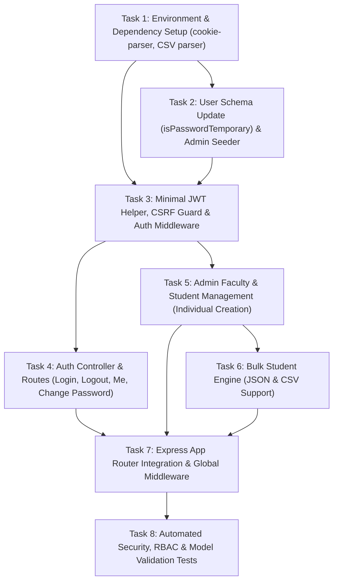

# Phase 03: Authentication & Role-Based Access Control (RBAC) - Implementation Plan

**Phase Number:** 03  
**Status:** Approved with Refinements (Executing)  
**Target:** Backend Authentication, Session Management, CSRF Protection, and User Administration  

---

## 1. Executive Summary & Four Approved Refinements

This plan defines the tasks for implementing secure user authentication and role-based access control (RBAC), updated to incorporate the four architectural refinements:

1. **Refinement 1: CSRF Protection & Consistent Cookie Lifecycle**
   * Cookie-authenticated state-changing requests (`POST`, `PUT`, `DELETE`, `PATCH`) are guarded by CSRF protection using a double-submit cookie pattern (`X-XSRF-TOKEN` header validated against an `xsrf-token` cookie) or custom request header verification.
   * Cookie options are centralized in a helper module (`COOKIE_OPTIONS`) guaranteeing identical `httpOnly`, `sameSite: 'lax'`, `path: '/'`, and `secure` configurations during both `login` (set) and `logout` (clear).
   * Dual-auth friendly: When requests authenticate via `Authorization: Bearer <token>` (e.g. Postman, CLI scripts, mobile), CSRF check is bypassed since Bearer tokens are not subject to ambient browser cookie-sending.

2. **Refinement 2: Minimal JWT Claims**
   * Token payload is strictly constrained to essential claims:
     ```javascript
     { id: user._id, role: user.role }
     ```
   * Full profile data (email, name, USN, account status) is queried securely by the backend via `req.user` in `verifyToken` middleware, ensuring tokens remain compact, tamper-resilient, and do not carry stale authorization data.

3. **Refinement 3: CSV & JSON Bulk Student Registration**
   * Endpoint `POST /api/admin/users/students/bulk` supports both:
     * JSON payload (`{ students: [...] }`)
     * CSV file / raw CSV text payload (`USN,Name,Email,Password`)
   * Includes header validation, row-by-row sanitization, duplicate detection (both intra-file and against existing database records), and returns a detailed import audit summary.

4. **Refinement 4: Mandatory Password Change for Temporary Passwords**
   * `User` schema includes `isPasswordTemporary: { type: Boolean, default: false }`.
   * When an Admin creates a Faculty or Student account with a generated initial password, `isPasswordTemporary` is set to `true`.
   * On login, response indicates `{ mustChangePassword: true }`.
   * New dedicated endpoint: `POST /api/auth/change-password` allowing users to supply `currentPassword` and `newPassword`, updating the password and setting `isPasswordTemporary: false`.
   * `enforcePasswordChange` middleware checks that users with temporary passwords are restricted from exam or quiz management routes until their password has been changed.

---

## 2. Graphify Architectural Impact Analysis

From Graphify analysis (`graphify-out/GRAPH_REPORT.md`):

```text
Affected Modules & Communities:
  ├── Community 0 (server/package.json, app.js):
  │     ├── Needs `cookie-parser` dependency
  │     └── Mounts cookie middleware, CSRF protection, and route handlers (/api/auth, /api/admin)
  ├── Community 2 (mongoose / User.js):
  │     ├── Added field: `isPasswordTemporary: Boolean`
  │     └── Consumed by authController, adminController, and seedAdmin
  └── Community 6 (server.js, db.js):
        └── seedAdmin.js uses db.js safe connection check
```

---

## 3. Task Dependency Graph



---

## 4. Execution Tasks & Acceptance Criteria

### Task 1: Environment & Dependency Setup
* **Objective:** Install `cookie-parser` and configure Admin environment secrets.
* **Target Files:**
  * [`server/package.json`](file:///C:/Users/babajan/OneDrive/Desktop/quizz/server/package.json)
  * [`server/.env`](file:///C:/Users/babajan/OneDrive/Desktop/quizz/server/.env)
  * [`server/.env.example`](file:///C:/Users/babajan/OneDrive/Desktop/quizz/server/.env.example)
* **Acceptance Criteria:**
  * `cookie-parser` installed in `server/node_modules`.
  * `ADMIN_NAME`, `ADMIN_EMAIL`, `ADMIN_PASSWORD` defined in `.env.example` and `.env`.

### Task 2: User Schema Update & Super Admin Seeder
* **Objective:** Add `isPasswordTemporary` field to User schema and create idempotent `seedAdmin.js`.
* **Target Files:**
  * [`server/src/models/User.js`](file:///C:/Users/babajan/OneDrive/Desktop/quizz/server/src/models/User.js)
  * [`server/src/utils/seedAdmin.js`](file:///C:/Users/babajan/OneDrive/Desktop/quizz/server/src/utils/seedAdmin.js)
* **Acceptance Criteria:**
  * Existing 21 model tests in `testModels.js` continue to pass.
  * `seedAdmin.js` connects safely, verifies if an Admin exists, creates one if missing with `isPasswordTemporary: false`, and logs clear feedback.

### Task 3: Minimal JWT, CSRF Guard & Auth Middleware
* **Objective:** Build minimal claims JWT utility, CSRF double-cookie guard, and role authorization middleware.
* **Target Files:**
  * [`server/src/utils/jwt.js`](file:///C:/Users/babajan/OneDrive/Desktop/quizz/server/src/utils/jwt.js)
  * [`server/src/middleware/csrfMiddleware.js`](file:///C:/Users/babajan/OneDrive/Desktop/quizz/server/src/middleware/csrfMiddleware.js)
  * [`server/src/middleware/authMiddleware.js`](file:///C:/Users/babajan/OneDrive/Desktop/quizz/server/src/middleware/authMiddleware.js)
* **Acceptance Criteria:**
  * JWT claims strictly contain `{ id, role }`.
  * Cookie options (SameSite, Path, HttpOnly, Secure) are centralized in `server/src/utils/cookieOptions.js`.
  * CSRF guard validates state-changing cookie requests while passing Bearer requests.
  * Role authorization returns HTTP 403 on role mismatch.

### Task 4: Auth Controller & Routes
* **Objective:** Implement Login, Logout, Profile (`/me`), and Password Change endpoints.
* **Target Files:**
  * [`server/src/controllers/authController.js`](file:///C:/Users/babajan/OneDrive/Desktop/quizz/server/src/controllers/authController.js)
  * [`server/src/routes/authRoutes.js`](file:///C:/Users/babajan/OneDrive/Desktop/quizz/server/src/routes/authRoutes.js)
* **Acceptance Criteria:**
  * `POST /api/auth/login` sets `httpOnly` cookie + CSRF token cookie, returns `{ success: true, token, user, mustChangePassword }`.
  * `POST /api/auth/logout` clears both cookies using identical options.
  * `POST /api/auth/change-password` requires authentication, verifies `currentPassword`, updates password, and sets `isPasswordTemporary: false`.

### Task 5: Admin Faculty & Student Management
* **Objective:** Allow Admin to create faculty and student accounts with temporary passwords.
* **Target Files:**
  * [`server/src/controllers/adminController.js`](file:///C:/Users/babajan/OneDrive/Desktop/quizz/server/src/controllers/adminController.js)
  * [`server/src/routes/adminRoutes.js`](file:///C:/Users/babajan/OneDrive/Desktop/quizz/server/src/routes/adminRoutes.js)
* **Acceptance Criteria:**
  * Creates faculty and student accounts with `isPasswordTemporary: true`.
  * Checks and prevents duplicate email or student USN before database insertion.

### Task 6: Bulk Student Registration (JSON & CSV Support)
* **Objective:** Support batch onboarding of students from JSON arrays or CSV formatted text.
* **Target Files:**
  * [`server/src/utils/csvParser.js`](file:///C:/Users/babajan/OneDrive/Desktop/quizz/server/src/utils/csvParser.js)
  * [`server/src/controllers/adminController.js`](file:///C:/Users/babajan/OneDrive/Desktop/quizz/server/src/controllers/adminController.js)
* **Acceptance Criteria:**
  * Supports CSV with header row `USN,Name,Email,Password` (or JSON array).
  * Validates mandatory USN, valid email format, and password length per row.
  * Skips duplicates and returns detailed summary: `{ totalRecords, createdCount, skippedCount, skippedDetails: [...] }`.

### Task 7: Express App Router Integration & Global Middleware
* **Objective:** Mount `cookie-parser`, CSRF middleware, and register `/api/auth` and `/api/admin` in `app.js`.
* **Target Files:**
  * [`server/src/app.js`](file:///C:/Users/babajan/OneDrive/Desktop/quizz/server/src/app.js)
* **Acceptance Criteria:**
  * All auth and admin endpoints accessible via Express app.
  * Health check `GET /api/health` continues to work cleanly.

### Task 8: Automated Security, RBAC & Model Validation Tests
* **Objective:** Run end-to-end automated tests verifying all requirements and regressions.
* **Target Files:**
  * [`server/src/utils/testAuth.js`](file:///C:/Users/babajan/OneDrive/Desktop/quizz/server/src/utils/testAuth.js)
* **Acceptance Criteria:**
  * Phase 2 model tests (`testModels.js`) pass with 0 failures.
  * Phase 3 auth tests (`testAuth.js`) pass with 0 failures:
    - Minimal JWT verification.
    - Password hashing & `changePassword` logic.
    - CSRF protection validation.
    - 401 unauthenticated & 403 forbidden role checks.
    - JSON & CSV bulk parser accuracy and duplicate filtering.
