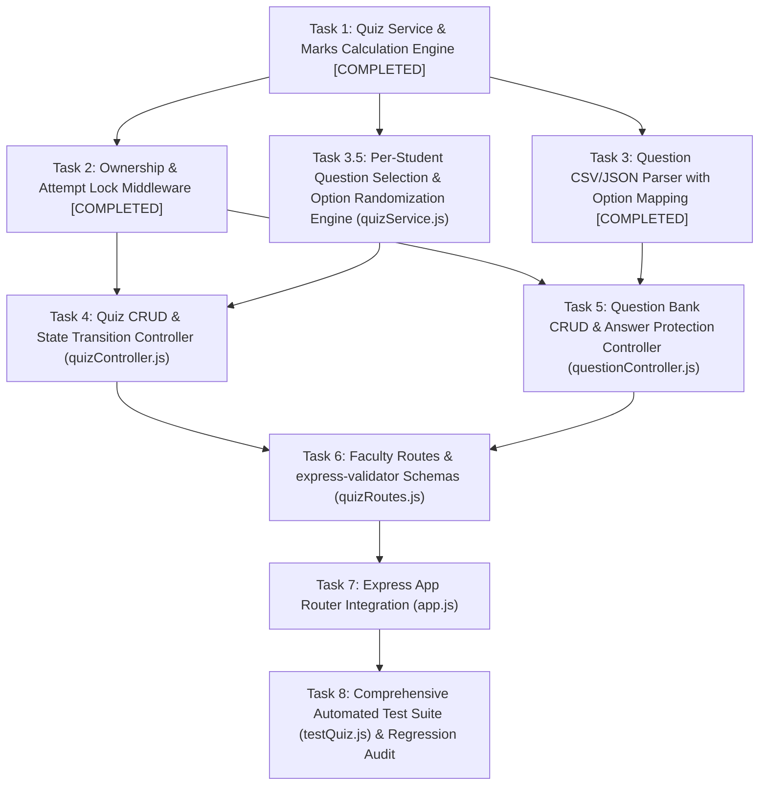

# Phase 04: Faculty Quiz Management & Question Engine - Implementation Plan

**Phase Number:** 04  
**Status:** Planned (Updated with Per-Student Selection & Randomization Engine - Awaiting Review)  
**Target:** Faculty Quiz Authoring, Question Bank Engine, Lifecycle State Controls, and Randomization Engine  

---

## 1. Executive Summary & Corrected Specifications

This plan defines the tasks for Phase 4, updated with the per-student question allocation and randomization engine:

1. **Equal Marks Rule for Subset Question Allocation:**
   * **Full-Question Mode (`questionsPerStudent === 0` or equals question bank count):**
     * `Quiz.totalMarks` = Sum of marks of all questions in the bank.
   * **Subset Allocation Mode (`questionsPerStudent > 0` and `< question bank count`):**
     * **Invariant:** Every student must have the exact same maximum possible score regardless of which random subset is assigned.
     * **Enforcement:** When `questionsPerStudent > 0`, all questions in the quiz bank must have identical mark values (e.g., all 1 mark, or all 2 marks). Publishing a quiz with unequal question marks in subset mode is rejected with HTTP 400.
     * `Quiz.totalMarks` = `questionsPerStudent * markPerQuestion`.

2. **Configurable Per-Student Selection & Randomization Engine (New D-06):**
   * **Configurable Allocation:** Faculty sets arbitrary `questionsPerStudent` (never hardcoded to 10 or fixed numbers; e.g. 10 out of 100, 25 out of 50).
   * **Different Question Sets:** High-entropy reservoir sampling ensures different students receive distinct question subsets whenever possible.
   * **Graceful Degradation:** If the question bank is too small for mathematical uniqueness, overlapping questions across students are allowed; the exam never crashes or fails.
   * **Full Pool Fallback:** If `questionsPerStudent === 0` or equals pool size, the entire question bank is allocated.
   * **Question Order Shuffling:** Shuffles question order independently per student when `randomizeQuestions: true`.
   * **Option Order Shuffling:** Shuffles answer options independently per question when `randomizeOptions: true`, preserving deterministic `optionId`s so backend answer evaluation against `correctOptionId` remains 100% reliable.
   * **Deterministic Persistence:** The assigned question order (`assignedQuestionOrder`) and shuffled option IDs (`assignedOptionOrder`) are stored permanently in the student's `Attempt` record. Page refreshes and network reconnects strictly read from this saved state and never regenerate.
   * **Zero Answer-Key Leaks:** `correctOptionId` is never transmitted to student-facing APIs.

3. **Deterministic Option Mapping & Validation in CSV/JSON Import:**
   * Option IDs are generated deterministically as `opt_1`, `opt_2`, `opt_3`, `opt_4` (and `opt_5` if provided).
   * `CorrectOptionId` can accept column letters (`A`, `B`, `C`, `D`) or direct IDs (`opt_1`, `opt_2`, etc.).
   * Validates that `CorrectOptionId` strictly references an option that exists in that specific question.
   * Row-level error reporting returning exact row numbers, field names, and actionable rejection reasons.

4. **Granular Attempt Locks & State Protection:**
   * **Question Mutations (`POST`, `PUT`, `DELETE`, `bulk`):** Blocked with HTTP 409 Conflict if `quiz.status === 'published'` and `Attempt.countDocuments({ quizId }) > 0`.
   * **Benign Metadata Updates:** Permitted even if attempts exist (description updates, emergency end-time extensions).
   * **Archived Quizzes:** Strictly read-only for both metadata and questions (HTTP 400).
   * **Data Preservation:** Deleting a quiz that has existing attempts is strictly blocked with HTTP 409 Conflict.

5. **Strict Ownership Pre-Check for Correct Answers:**
   * Ownership verification (`createdBy === req.user._id` or `role === 'admin'`) executes before database projection of `correctOptionId`.

---

## 2. Graphify Architectural Impact Analysis

From Graphify AST analysis:

```text
Affected Communities & Modules:
  ├── Community 2 (mongoose / Quiz.js, Question.js, Attempt.js):
  │     ├── `Quiz`: holds `questionsPerStudent`, `randomizeQuestions`, `randomizeOptions`
  │     ├── `Question`: options array & hidden `correctOptionId`
  │     └── `Attempt`: already has `assignedQuestionOrder` and `assignedOptionOrder` schemas
  │           (VERIFIED: Zero schema changes required on Attempt model!)
  ├── Community 3 (app.js / authMiddleware.js):
  │     ├── `verifyToken`, `authorizeRoles('faculty', 'admin')`, `enforcePasswordChange`
  │     └── Mounts `/api/faculty/quizzes` route tree
  └── Utilities & Services:
        ├── `server/src/utils/quizService.js`:
        │     ├── recalculateQuizTotalMarks() [COMPLETED]
        │     ├── validateSubsetMarksConsistency() [COMPLETED]
        │     └── generateStudentExamAllocation() [TASK 3.5 OWNERSHIP]
        ├── `server/src/middleware/quizMiddleware.js`: Ownership & Attempt Locks [COMPLETED]
        └── `server/src/utils/questionCsvParser.js`: Option Mapping & Parser [COMPLETED]
```

---

## 3. Task Dependency Graph



---

## 4. Task Breakdown & Ownership

### Task 1: Quiz Service & Equal-Mark Allocation Engine [COMPLETED]
* **Target File:** `server/src/utils/quizService.js` (Verified with `server/src/utils/testQuizService.js`)
* Implements `recalculateQuizTotalMarks` and `validateSubsetMarksConsistency`.

---

### Task 2: Granular Ownership & Attempt Lock Middleware [COMPLETED]
* **Target File:** `server/src/middleware/quizMiddleware.js` (Verified with `server/src/utils/testQuizMiddleware.js`)
* Implements `verifyQuizOwnership`, `checkQuestionModificationLock`, and `checkQuizDeletionLock`.

---

### Task 3: Deterministic Option Mapping & Question Ingestion Utility [COMPLETED]
* **Target File:** `server/src/utils/questionCsvParser.js` (Verified with `server/src/utils/testQuestionParser.js`)
* Implements RFC 4180 CSV tokenizer, True/False generation, option ID mapping, and row error reporting.

---

### Task 3.5: Per-Student Question Selection & Option Randomization Engine [COMPLETED]
* **Ownership:** Added to `server/src/utils/quizService.js` (Verified with `server/src/utils/testRandomization.js`)
* **Target Functions:** `generateStudentExamAllocation(quiz, allQuestions, existingSignatures)`, `sanitizeQuestionsForStudent(allQuestions, assignedQuestionOrder, assignedOptionOrder)`, `secureShuffle`, `secureSample`
* **Deliverables:**
  1. **Subset Selection:**
     - Reads `allocation = quiz.questionsPerStudent || 0`.
     - If `allocation === 0` or `allocation >= allQuestions.length`: uses full question pool.
     - If `allocation > 0` and `allocation < allQuestions.length`: randomly samples `allocation` questions from the pool using Fisher-Yates partial shuffle.
     - Allows overlapping questions when the pool is small without failing or throwing.
  2. **Question Order Shuffling:**
     - If `quiz.randomizeQuestions !== false`: shuffles selected question array order.
     - Produces `assignedQuestionOrder: [questionId, ...]`.
  3. **Option Order Shuffling:**
     - For each question in `assignedQuestionOrder`:
       - If `quiz.randomizeOptions !== false`: shuffles question's options array.
       - Stores `shuffledOptionIds: [optionId, ...]`.
     - Produces `assignedOptionOrder: [{ questionId, shuffledOptionIds }]`.
  4. **Student View Projection Helper (`sanitizeQuestionsForStudent`):**
     - Orders options according to `shuffledOptionIds`.
     - Omits `correctOptionId` completely.
  5. **Attempt Payload Preparation:**
     - Returns `{ assignedQuestionOrder, assignedOptionOrder, totalMarksPossible }` matching the `Attempt` schema so that resuming/refreshing the exam strictly retrieves the saved session without generating new sets.
* **Acceptance Criteria:**
  - Generates different random subsets across multiple runs when `questionsPerStudent < pool size`.
  - Generates shuffled option lists while preserving original option IDs for backend evaluation.
  - Returns structure matching `Attempt.assignedQuestionOrder` and `Attempt.assignedOptionOrder`.
  - Zero answer-key leaks in student-facing projected payload.

---

### Task 4: Quiz CRUD & Lifecycle Controller [COMPLETED]
* **Target File:** `server/src/controllers/quizController.js` (Verified with `server/src/utils/testQuizController.js`)
* **Functions:** `createQuiz`, `getQuizzes`, `getQuizById`, `updateQuiz`, `updateQuizStatus`, `deleteQuiz`
* **Endpoints:**
  * `POST /api/faculty/quizzes`: Create draft quiz (supports `questionsPerStudent`, `randomizeQuestions`, `randomizeOptions`).
  * `GET /api/faculty/quizzes`: List quizzes authored by this faculty (or all if admin).
  * `GET /api/faculty/quizzes/:quizId`: Get quiz details, question count, and attempt statistics.
  * `PUT /api/faculty/quizzes/:quizId`: Update quiz metadata (permits description updates and end-time extensions; blocks duration reduction or question count changes if attempts exist).
  * `PATCH /api/faculty/quizzes/:quizId/status`:
    * `draft` $\rightarrow$ `published`: Validates `questionCount >= 1`, `endTime > startTime`, and equal marks if `questionsPerStudent > 0`.
    * `published` $\rightarrow$ `archived`: Retains all data in read-only mode.
  * `DELETE /api/faculty/quizzes/:quizId`: Deletes quiz and associated questions (blocked with HTTP 409 if attempts exist).

---

### Task 5: Question Bank CRUD & Answer Protection Controller [COMPLETED]
* **Target File:** `server/src/controllers/questionController.js` (Verified with `server/src/utils/testQuestionController.js`)
* **Functions:** `createQuestion`, `getQuestions`, `getQuestionById`, `updateQuestion`, `deleteQuestion`, `bulkImportQuestions`
* **Endpoints:**
  * `POST /api/faculty/quizzes/:quizId/questions`: Add question (MCQ or True/False). Recomputes total marks.
  * `GET /api/faculty/quizzes/:quizId/questions`: Returns questions for verified owner, explicitly selecting `.select('+correctOptionId')`.
  * `PUT /api/faculty/quizzes/:quizId/questions/:questionId`: Update question text, options, correct answer, or marks. Recomputes total marks.
  * `DELETE /api/faculty/quizzes/:quizId/questions/:questionId`: Delete question. Recomputes total marks.
  * `POST /api/faculty/quizzes/:quizId/questions/bulk`: Batch import questions via JSON array or CSV payload using `questionCsvParser.js`.

---

### Task 6: Faculty Routes Assembly & Input Validation [COMPLETED]
* **Target File:** `server/src/routes/quizRoutes.js` (Verified with `server/src/utils/testQuizRoutes.js`)
* **Middleware Chain:**
  * Global: `verifyToken`, `authorizeRoles('faculty', 'admin')`, `enforcePasswordChange`.
  * Quiz-specific: `verifyQuizOwnership`.
  * Question mutations: `checkQuestionModificationLock`.
  * Quiz deletion: `checkQuizDeletionLock`.

---

### Task 7: Express App Router Integration
* **Target File:** `server/src/app.js`
* Mounts `/api/faculty/quizzes` cleanly alongside `/api/auth` and `/api/admin`.

---

### Task 8: Automated Test Suite & Regression Verification
* **Target File:** `server/src/utils/testQuiz.js`
* Tests end-to-end quiz CRUD, question bank, randomization engine, state locks, and answer isolation.
* Verifies all existing regression suites (Phase 2, Phase 3, Tasks 1–3).
